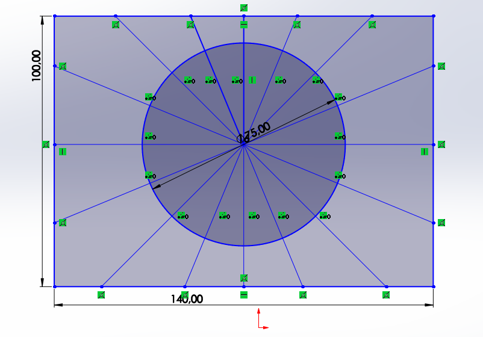

# SolidWorks Çizim Çalışması 3

## Bu çalışmada ne yaptım?

Bu çalışmada SolidWorks üzerinde eksen çizgileri (centerlines) oluşturmayı, merkez noktadan daire çizmeyi ve açılı/radyal referans hatları dağıtarak karmaşık 2D geometri kurmayı öğrendim. Akıllı ölçülendirmeyle dış çerçeve ve daire çapı ölçülerini tanımladım.

## Öğrendiklerim

* Merkez noktadan daire çizmek ve çapını ayarlamak
* Eksen çizgileri (centerlines) ile simetri ve referans hatları oluşturmak
* Akıllı ölçülendirme (Smart Dimension) ile doğru ölçüleri vermek[cite: 3]
* Çizimde ölçüleri ve geometrik ilişkileri doğru şekilde ayarlamak[cite: 3]

## Dosyalar

* `Parça3.SLDPRT` – Çizimin SolidWorks dosyası[cite: 3]
* `Parça3.png` – Ölçülendirilmiş çizimin ekran görüntüsü[cite: 3]

Bu çalışmayla birlikte SolidWorks'te dairesel formlar ve gelişmiş 2D çizim konularında pratik yaptım.

